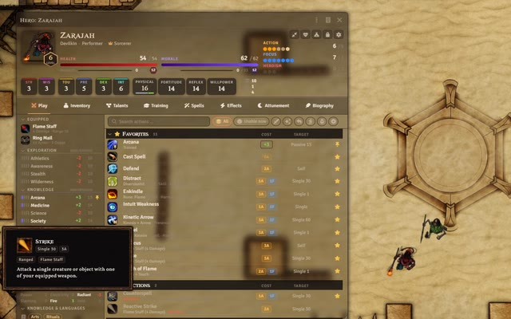
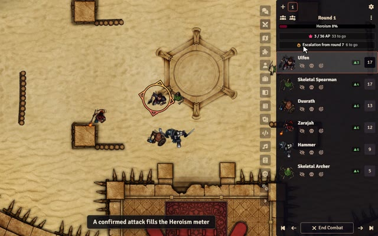
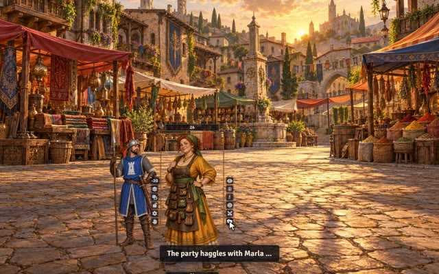
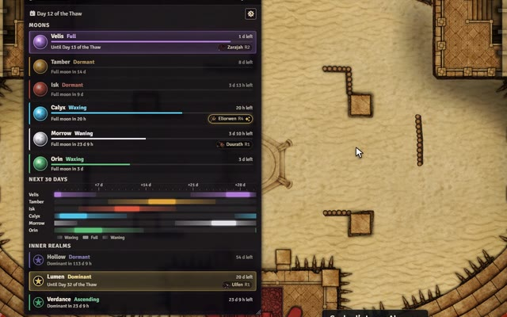

## Hi, I'm Sephral

I build modules for [Foundry Virtual Tabletop](https://foundryvtt.com). They are free, and every one of them comes in English and German.

Install them from Foundry's own module browser: search for **Sephral**.

## Modules for every system

<table>
<tr>
<td width="300" valign="top"></td>
<td valign="top">

### [Image Paste & Drop](https://github.com/Sephral/sephrals-image-paste-drop)
Foundry v13 and v14 · any system

Paste an image with Ctrl+V or drop it onto Foundry and decide what it becomes: a new scene, the background of the current scene, a tile, a journal page or a picture shown to your players.

[Foundry package](https://foundryvtt.com/packages/sephrals-image-paste-drop) · [GitHub](https://github.com/Sephral/sephrals-image-paste-drop) · 

</td>
</tr>
<tr>
<td width="300" valign="top"></td>
<td valign="top">

### [Content Backup & Restore](https://github.com/Sephral/sephrals-content-backup-restore)
Foundry v13 and v14 · any system

Named backups for scenes, actors, items, journals, playlists, macros, roll tables and cards. Restore a document from any of its backups or recover one that was deleted. Backups are one right click away in the sidebar.

[Foundry package](https://foundryvtt.com/packages/sephrals-content-backup-restore) · [GitHub](https://github.com/Sephral/sephrals-content-backup-restore) · 

</td>
</tr>
<tr>
<td width="300" valign="top"></td>
<td valign="top">

### [Roll Triggers](https://github.com/Sephral/sephrals-roll-triggers)
Foundry v13 and v14 · any system

House rules for special rolls: natural 20s, fumbles, doubles, exact values and more. A trigger can post a message, roll on a table, run a macro or wait until the GM confirms it. Starter profiles for many popular systems are included.

[Foundry package](https://foundryvtt.com/packages/sephrals-roll-triggers) · [GitHub](https://github.com/Sephral/sephrals-roll-triggers) · 

</td>
</tr>
<tr>
<td width="300" valign="top"></td>
<td valign="top">

### [Roll Breakdown](https://github.com/Sephral/sephrals-roll-breakdown)
Foundry v13 and v14 · any system, extra details for D&amp;D 5e

Adds a compact panel to roll messages that shows where every number comes from: dice, modifiers and the parts of a formula that stay unresolved. In D&D 5e it also lists the reasons for advantage and disadvantage when the roll data provides them.

[Foundry package](https://foundryvtt.com/packages/sephrals-roll-breakdown) · [GitHub](https://github.com/Sephral/sephrals-roll-breakdown) · 

</td>
</tr>
<tr>
<td width="300" valign="top"></td>
<td valign="top">

### [Player Notes](https://github.com/Sephral/sephrals-player-notes)
Foundry v13 and v14 · any system

Private GM notes attached to player characters: story hooks, secrets, promises, debts and reminders for the next session. A dashboard shows what is still open for the whole party.

[Foundry package](https://foundryvtt.com/packages/sephrals-player-notes) · [GitHub](https://github.com/Sephral/sephrals-player-notes) · 

</td>
</tr>
<tr>
<td width="300" valign="top"></td>
<td valign="top">

### [Module Loadouts](https://github.com/Sephral/sephrals-module-loadouts)
Foundry v13 and v14 · any system

Save the active modules as a named loadout, compare it with the current setup and switch with one click. Loadouts work for one world or for the whole installation and can be exported as JSON.

[Foundry package](https://foundryvtt.com/packages/sephrals-module-loadouts) · [GitHub](https://github.com/Sephral/sephrals-module-loadouts) · 

</td>
</tr>
<tr>
<td width="300" valign="top"></td>
<td valign="top">

### [File Commander](https://github.com/Sephral/sephrals-file-commander)
Foundry v13 and v14 · any system

A file manager with two panels side by side, controlled by keyboard like the classic commanders. Browse Foundry's storage, copy folders from one side to the other, upload files and create new folders.

[Foundry package](https://foundryvtt.com/packages/sephrals-file-commander) · [GitHub](https://github.com/Sephral/sephrals-file-commander) · 

</td>
</tr>
</table>

## In development

These modules already have public repositories but no release yet.

<table>
<tr>
<td width="300" valign="top"></td>
<td valign="top">

### [Combat Log & Stats](https://github.com/Sephral/sephrals-combat-log-stats)
Foundry v13 and v14 · any system, exact attribution in D&amp;D 5e

Records every fight round by round: damage, healing, takedowns, close calls and control effects for each combatant. The GM can share a player friendly report in chat or as a journal.

</td>
</tr>
<tr>
<td width="300" valign="top"></td>
<td valign="top">

### [Crucible Sheet & Quickbar](https://github.com/Sephral/sephrals-crucible-sheet-quickbar)
Foundry v14 · Crucible

A compact hero and adversary sheet for Crucible. Resources, defenses and actions stay in view, composed spells live in a spellbook, and in combat the sheet shrinks into a small quickbar. Each player decides which characters use it.

</td>
</tr>
<tr>
<td width="300" valign="top"></td>
<td valign="top">

### [Crucible Combat Pulse](https://github.com/Sephral/sephrals-crucible-combat-pulse)
Foundry v14 · Crucible

Shows the hidden pulse of a Crucible fight in the combat tracker: the exact progress to the next Heroism point, the Morale escalation from round 7 and a forecast of every combatant's next initiative roll.

</td>
</tr>
<tr>
<td width="300" valign="top"></td>
<td valign="top">

### [Vista Portrait Switcher](https://github.com/Sephral/sephrals-vista-portrait-switcher)
Foundry v14 · Crucible with Ember

Change the portrait of an NPC in Ember's Vista scenes in the middle of a conversation: a gallery with any number of portraits per character, a palette in the token HUD and a soft transition.

</td>
</tr>
<tr>
<td width="300" valign="top"></td>
<td valign="top">

### [Lunar Almanac](https://github.com/Sephral/sephrals-lunar-almanac)
Foundry v14 · Crucible with Ember

An almanac for the sky of Ember: the phase of every moon and how long it lasts, the next full moon, a timeline of the coming days and the heroes attuned to each moon, with optional notifications.

</td>
</tr>
</table>

## Support

Questions, ideas and bug reports are welcome on [Discord](https://discord.gg/7BjCgDYaBP) or as an issue in the repository of the module.

Foundry Virtual Tabletop is a trademark of Foundry Gaming LLC. These modules are independent fan projects and are not affiliated with or endorsed by Foundry Gaming LLC.
