## Hi, I'm Sephral

I build modules for [Foundry Virtual Tabletop](https://foundryvtt.com). They are free, and every one of them comes in English and German.

All of them are in Foundry's own module browser: search for **Sephral**.

**Jump to:** [Crucible and Ember](#made-for-crucible-and-ember) · [Every system](#modules-for-every-system) · [Support](#support)

## Made for Crucible and Ember

**Crucible** is the game system built only for Foundry. **Ember** is the open world campaign from the Foundry team, playable with Crucible or D&D 5e. These four modules bring more to that table: a sheet that keeps up with fast turns, a combat tracker that shows what Crucible keeps hidden, NPCs that change their mood in the Vistas and an almanac for the moons above Ember.

All four need Foundry v14. Vista Portrait Switcher and Lunar Almanac work with your own copy of Ember and contain none of its content.

<table>
<tr>
<td width="50%" valign="top">

<a href="https://github.com/Sephral/sephrals-crucible-sheet-quickbar">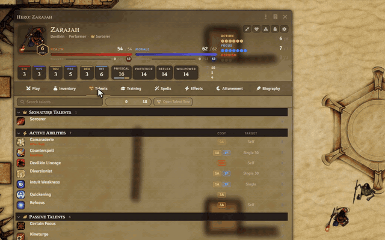</a>

### [Crucible Sheet & Quickbar](https://github.com/Sephral/sephrals-crucible-sheet-quickbar)
Foundry v14 · Crucible · Ember optional

**Everything your hero can do, on one compact sheet.** When the fight starts, it shrinks into a quickbar that stays on the map.

* Resources and defenses always in view
* Shows which actions you can pay right now
* A spellbook for composed spells
* Each player picks it for their own heroes

[Foundry package](https://foundryvtt.com/packages/sephrals-crucible-sheet-quickbar) · [GitHub](https://github.com/Sephral/sephrals-crucible-sheet-quickbar) · 

</td>
<td width="50%" valign="top">

<a href="https://github.com/Sephral/sephrals-crucible-combat-pulse">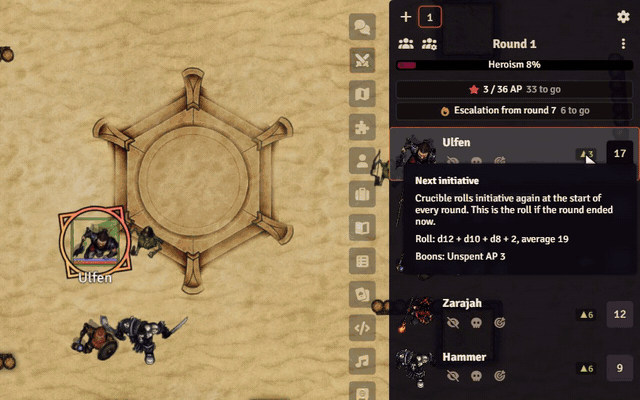</a>

### [Crucible Combat Pulse](https://github.com/Sephral/sephrals-crucible-combat-pulse)
Foundry v14 · Crucible

**Crucible fights have a pulse nobody at the table can see.** Combat Pulse puts it into the combat tracker.

* Exact progress to the next Heroism point
* Countdown to the Morale escalation
* Forecast of everyone's next initiative
* Never rolls dice or changes an actor

[Foundry package](https://foundryvtt.com/packages/sephrals-crucible-combat-pulse) · [GitHub](https://github.com/Sephral/sephrals-crucible-combat-pulse) · 

</td>
</tr>
<tr>
<td width="50%" valign="top">

<a href="https://github.com/Sephral/sephrals-vista-portrait-switcher">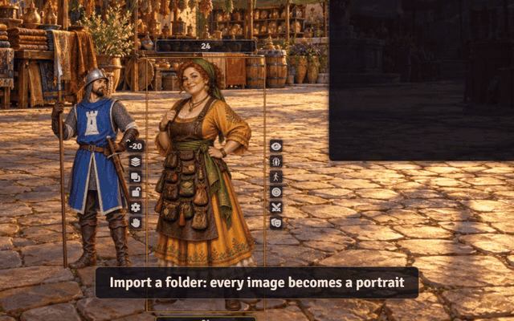</a>

### [Vista Portrait Switcher](https://github.com/Sephral/sephrals-vista-portrait-switcher)
Foundry v14 · Ember with Crucible or D&amp;D 5e

**Bring the NPCs in Ember's Vistas to life.** The merchant turns suspicious, the guard reaches for his sword. One click, and the figure changes with a soft transition.

* Any number of portraits per character
* A palette right in the token HUD
* Import a whole folder in seconds
* Players can switch their own heroes too

[Foundry package](https://foundryvtt.com/packages/sephrals-vista-portrait-switcher) · [GitHub](https://github.com/Sephral/sephrals-vista-portrait-switcher) · 

</td>
<td width="50%" valign="top">

<a href="https://github.com/Sephral/sephrals-lunar-almanac">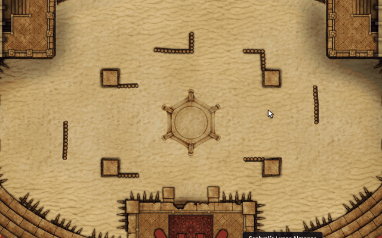</a>

### [Lunar Almanac](https://github.com/Sephral/sephrals-lunar-almanac)
Foundry v14 · Ember, tested with Crucible

**When does the next full moon rise over Ember, and which heroes are waiting for it?** Ember's calendar shows today's sky. The almanac shows what comes next.

* Moons and inner realms with their phases
* A timeline of the coming 30 days
* The heroes attuned to each moon
* A message when a moon becomes full

[Foundry package](https://foundryvtt.com/packages/sephrals-lunar-almanac) · [GitHub](https://github.com/Sephral/sephrals-lunar-almanac) · 

</td>
</tr>
</table>

The previews use Crucible's pregenerated heroes and stand in art made for the demos. They show no Ember content.

## Modules for every system

For Foundry v13 and v14, with any game system.

<table>
<tr>
<td width="300" valign="top"><a href="https://github.com/Sephral/sephrals-image-paste-drop">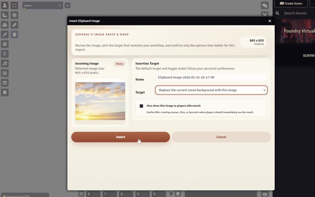</a></td>
<td valign="top">

### [Image Paste & Drop](https://github.com/Sephral/sephrals-image-paste-drop)
Foundry v13 and v14 · any system

Paste an image with Ctrl+V or drop it onto Foundry and decide what it becomes: a new scene, the background of the current scene, a tile, a journal page or a picture shown to your players.

[Foundry package](https://foundryvtt.com/packages/sephrals-image-paste-drop) · [GitHub](https://github.com/Sephral/sephrals-image-paste-drop) · 

</td>
</tr>
<tr>
<td width="300" valign="top"><a href="https://github.com/Sephral/sephrals-content-backup-restore">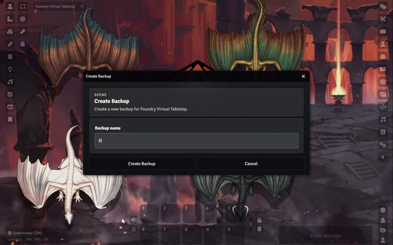</a></td>
<td valign="top">

### [Content Backup & Restore](https://github.com/Sephral/sephrals-content-backup-restore)
Foundry v13 and v14 · any system

Named backups for scenes, actors, items, journals, playlists, macros, roll tables and cards. Restore a document from any of its backups or recover one that was deleted. Backups are one right click away in the sidebar.

[Foundry package](https://foundryvtt.com/packages/sephrals-content-backup-restore) · [GitHub](https://github.com/Sephral/sephrals-content-backup-restore) · 

</td>
</tr>
<tr>
<td width="300" valign="top"><a href="https://github.com/Sephral/sephrals-roll-triggers">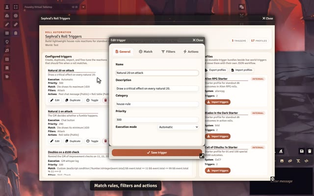</a></td>
<td valign="top">

### [Roll Triggers](https://github.com/Sephral/sephrals-roll-triggers)
Foundry v13 and v14 · any system

House rules for special rolls: natural 20s, fumbles, doubles, exact values and more. A trigger can post a message, roll on a table, run a macro or wait until the GM confirms it. Starter profiles for many popular systems are included.

[Foundry package](https://foundryvtt.com/packages/sephrals-roll-triggers) · [GitHub](https://github.com/Sephral/sephrals-roll-triggers) · 

</td>
</tr>
<tr>
<td width="300" valign="top"><a href="https://github.com/Sephral/sephrals-roll-breakdown">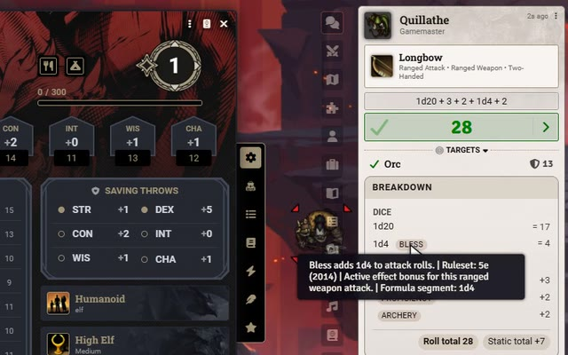</a></td>
<td valign="top">

### [Roll Breakdown](https://github.com/Sephral/sephrals-roll-breakdown)
Foundry v13 and v14 · any system, extra details for D&amp;D 5e

Adds a compact panel to roll messages that shows where every number comes from: dice, modifiers and the parts of a formula that stay unresolved. In D&D 5e it also lists the reasons for advantage and disadvantage when the roll data provides them.

[Foundry package](https://foundryvtt.com/packages/sephrals-roll-breakdown) · [GitHub](https://github.com/Sephral/sephrals-roll-breakdown) · 

</td>
</tr>
<tr>
<td width="300" valign="top"><a href="https://github.com/Sephral/sephrals-player-notes">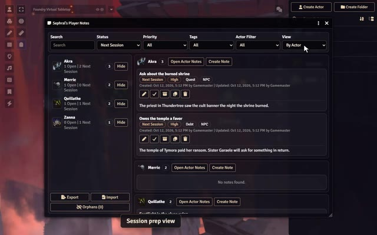</a></td>
<td valign="top">

### [Player Notes](https://github.com/Sephral/sephrals-player-notes)
Foundry v13 and v14 · any system

Private GM notes attached to player characters: story hooks, secrets, promises, debts and reminders for the next session. A dashboard shows what is still open for the whole party.

[Foundry package](https://foundryvtt.com/packages/sephrals-player-notes) · [GitHub](https://github.com/Sephral/sephrals-player-notes) · 

</td>
</tr>
<tr>
<td width="300" valign="top"><a href="https://github.com/Sephral/sephrals-module-loadouts">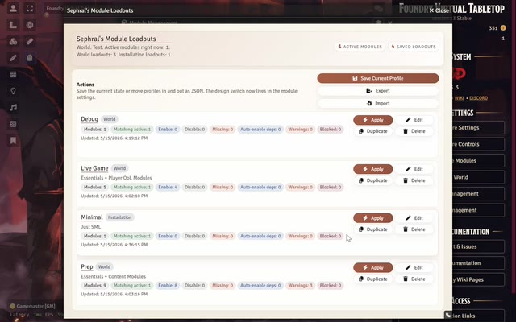</a></td>
<td valign="top">

### [Module Loadouts](https://github.com/Sephral/sephrals-module-loadouts)
Foundry v13 and v14 · any system

Save the active modules as a named loadout, compare it with the current setup and switch with one click. Loadouts work for one world or for the whole installation and can be exported as JSON.

[Foundry package](https://foundryvtt.com/packages/sephrals-module-loadouts) · [GitHub](https://github.com/Sephral/sephrals-module-loadouts) · 

</td>
</tr>
<tr>
<td width="300" valign="top"><a href="https://github.com/Sephral/sephrals-file-commander">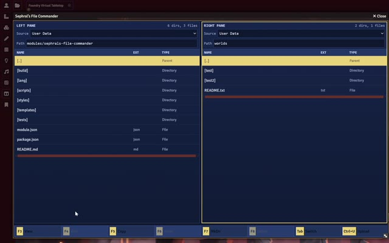</a></td>
<td valign="top">

### [File Commander](https://github.com/Sephral/sephrals-file-commander)
Foundry v13 and v14 · any system

A file manager with two panels side by side, controlled by keyboard like the classic commanders. Browse Foundry's storage, copy folders from one side to the other, upload files and create new folders.

[Foundry package](https://foundryvtt.com/packages/sephrals-file-commander) · [GitHub](https://github.com/Sephral/sephrals-file-commander) · 

</td>
</tr>
<tr>
<td width="300" valign="top"><a href="https://github.com/Sephral/sephrals-combat-log-stats">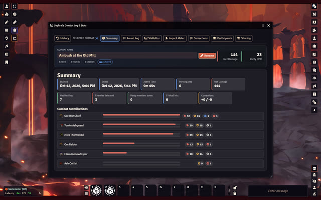</a></td>
<td valign="top">

### [Combat Log & Stats](https://github.com/Sephral/sephrals-combat-log-stats)
Foundry v13 and v14 · any system, exact attribution in D&amp;D 5e

Records every fight round by round: damage, healing, takedowns, close calls and control effects for each combatant. The GM can share a player friendly report in chat or as a journal.

[Foundry package](https://foundryvtt.com/packages/sephrals-combat-log-stats) · [GitHub](https://github.com/Sephral/sephrals-combat-log-stats) · 

</td>
</tr>
</table>

## Support

Questions, ideas and bug reports are welcome on [Discord](https://discord.gg/7BjCgDYaBP) or as an issue in the repository of the module.

Foundry Virtual Tabletop is a trademark of Foundry Gaming LLC. Crucible and Ember belong to their creators. These modules are independent fan projects and are not affiliated with or endorsed by Foundry Gaming LLC or the creators of Crucible and Ember.
