## Hi, I'm Sephral

I build modules for [Foundry Virtual Tabletop](https://foundryvtt.com). All 23 are free, and every one of them comes in English and German. For Foundry v13 and v14, with any game system unless a module says otherwise.

You find them in Foundry's own module browser: search for **Sephral**. One is not in that search: Performance Doctor, which installs by its link right below.

**Jump to:** [Crucible and Ember](#made-for-crucible-and-ember) · [At the table](#at-the-table) · [Running the game](#running-the-game) · [Behind the scenes](#behind-the-scenes) · [Install by link](#install-by-link) · [Support](#support)

[](https://discord.gg/7BjCgDYaBP)

---

<a href="https://github.com/Sephral/sephrals-performance-doctor"></a>

<table>
<tr>
<td width="58%" valign="top">

<a href="https://github.com/Sephral/sephrals-performance-doctor">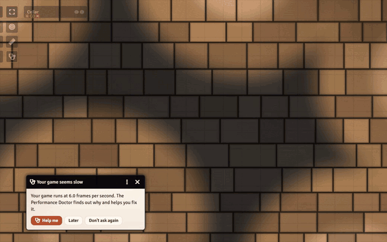</a>

</td>
<td width="42%" valign="top">

### [Performance Doctor](https://github.com/Sephral/sephrals-performance-doctor)

* Names the cause in plain words
* **Make my game faster:** one click, and everything can be undone
* Shows which module eats the time
* The GM sees the whole table

[GitHub](https://github.com/Sephral/sephrals-performance-doctor) · 

</td>
</tr>
</table>

Not in Foundry's module search. Copy this link and paste it as Manifest URL, [here is how](#install-by-link).

```text
https://github.com/Sephral/sephrals-performance-doctor/releases/latest/download/module.json
```

## Made for Crucible and Ember

**Crucible** is the game system built only for Foundry. **Ember** is the open world campaign from the Foundry team, playable with Crucible or D&D 5e. All four need Foundry v14. The two Ember modules work with your own copy of Ember and contain none of its content.

<table>
<tr>
<td width="50%" valign="top">

<a href="https://github.com/Sephral/sephrals-crucible-sheet-quickbar">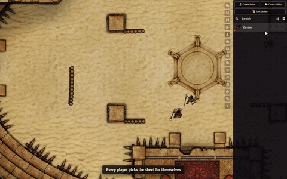</a>

### [Crucible Sheet & Quickbar](https://github.com/Sephral/sephrals-crucible-sheet-quickbar)

**Everything your hero can do, on one compact sheet.** When the fight starts, it shrinks into a quickbar that stays on the map.

[Foundry package](https://foundryvtt.com/packages/sephrals-crucible-sheet-quickbar) · [GitHub](https://github.com/Sephral/sephrals-crucible-sheet-quickbar) · <br>
<sub>Foundry v14 · Crucible · Ember optional</sub>

</td>
<td width="50%" valign="top">

<a href="https://github.com/Sephral/sephrals-crucible-combat-pulse">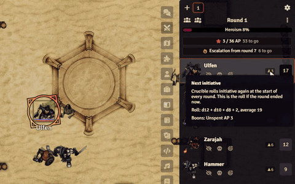</a>

### [Crucible Combat Pulse](https://github.com/Sephral/sephrals-crucible-combat-pulse)

**Crucible fights have a pulse nobody at the table can see.** Combat Pulse puts it into the combat tracker.

[Foundry package](https://foundryvtt.com/packages/sephrals-crucible-combat-pulse) · [GitHub](https://github.com/Sephral/sephrals-crucible-combat-pulse) · <br>
<sub>Foundry v14 · Crucible</sub>

</td>
</tr>
<tr>
<td width="50%" valign="top">

<a href="https://github.com/Sephral/sephrals-vista-portrait-switcher">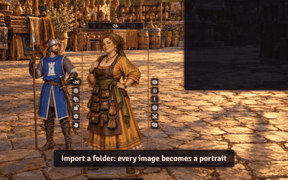</a>

### [Vista Portrait Switcher](https://github.com/Sephral/sephrals-vista-portrait-switcher)

**Bring the NPCs in Ember's Vistas to life.** One click, and the figure changes with a soft transition.

[Foundry package](https://foundryvtt.com/packages/sephrals-vista-portrait-switcher) · [GitHub](https://github.com/Sephral/sephrals-vista-portrait-switcher) · <br>
<sub>Foundry v14 · Ember with Crucible or D&amp;D 5e</sub>

</td>
<td width="50%" valign="top">

<a href="https://github.com/Sephral/sephrals-lunar-almanac">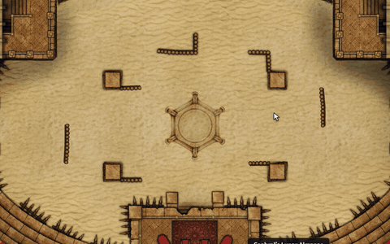</a>

### [Lunar Almanac](https://github.com/Sephral/sephrals-lunar-almanac)

**When does the next full moon rise over Ember?** Ember's calendar shows today's sky. The almanac shows what comes next.

[Foundry package](https://foundryvtt.com/packages/sephrals-lunar-almanac) · [GitHub](https://github.com/Sephral/sephrals-lunar-almanac) · <br>
<sub>Foundry v14 · Ember, tested with Crucible</sub>

</td>
</tr>
</table>

<sub>The previews use Crucible's pregenerated heroes and stand in art made for the demos. They show no Ember content.</sub>

## At the table

What everyone at the table sees, rolls and remembers.

<table>
<tr>
<td width="50%" valign="top">

<a href="https://github.com/Sephral/sephrals-swift-dice">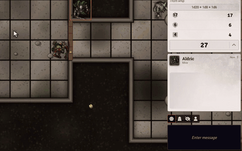</a>

### [Swift Dice](https://github.com/Sephral/sephrals-swift-dice)

**Light 3D dice for every roll that never hold up the game.** No WebGL and no physics engine, so they run on old laptops, tablets and in Firefox.

[Foundry package](https://foundryvtt.com/packages/sephrals-swift-dice) · [GitHub](https://github.com/Sephral/sephrals-swift-dice) · 

</td>
<td width="50%" valign="top">

<a href="https://github.com/Sephral/sephrals-tavern-games">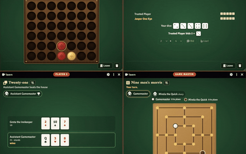</a>

### [Tavern Games](https://github.com/Sephral/sephrals-tavern-games)

**Eight games for the tavern table.** From nine men's morris to liar's dice. Play against each other or the regulars of the inn.

[Foundry package](https://foundryvtt.com/packages/sephrals-tavern-games) · [GitHub](https://github.com/Sephral/sephrals-tavern-games) · 

</td>
</tr>
<tr>
<td width="50%" valign="top">

<a href="https://github.com/Sephral/sephrals-campaign-album">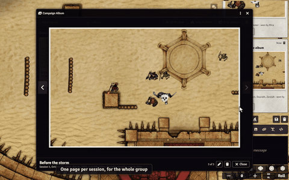</a>

### [Campaign Album](https://github.com/Sephral/sephrals-campaign-album)

**Photos of the big moments, exactly as your players saw them.** One page per session, with a slideshow for the end of the evening.

[Foundry package](https://foundryvtt.com/packages/sephrals-campaign-album) · [GitHub](https://github.com/Sephral/sephrals-campaign-album) · 

</td>
<td width="50%" valign="top">

<a href="https://github.com/Sephral/sephrals-table-compass">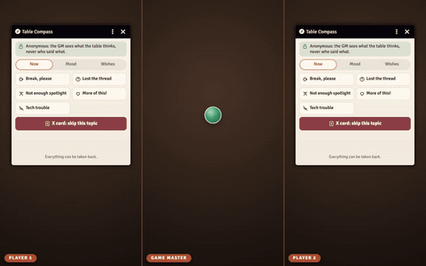</a>

### [Table Compass](https://github.com/Sephral/sephrals-table-compass)

**Anonymous feedback from the players to the GM.** The GM sees the mood of the table in one small window, never who said what.

[Foundry package](https://foundryvtt.com/packages/sephrals-table-compass) · [GitHub](https://github.com/Sephral/sephrals-table-compass) · 

</td>
</tr>
<tr>
<td width="50%" valign="top">

<a href="https://github.com/Sephral/sephrals-roll-breakdown">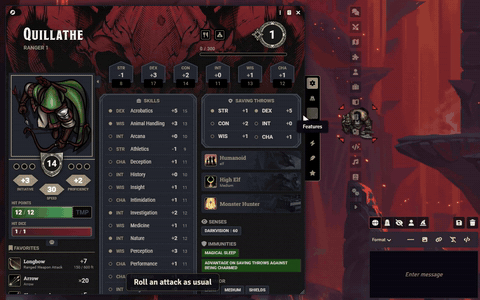</a>

### [Roll Breakdown](https://github.com/Sephral/sephrals-roll-breakdown)

**See where every number comes from.** A compact panel on roll messages shows the dice, the modifiers and the reasons for advantage.

[Foundry package](https://foundryvtt.com/packages/sephrals-roll-breakdown) · [GitHub](https://github.com/Sephral/sephrals-roll-breakdown) · <br>
<sub>Extra details for D&amp;D 5e, Crucible, Pathfinder 2e and Savage Worlds · works with MidiQOL and Ready Set Roll</sub>

</td>
<td width="50%" valign="top">

<a href="https://github.com/Sephral/sephrals-combat-log-stats">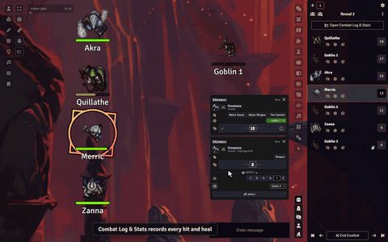</a>

### [Combat Log & Stats](https://github.com/Sephral/sephrals-combat-log-stats)

**Every fight recorded, round by round.** With charts and awards such as MVP and Best Healer. Share a report in chat, as a journal or on Discord.

[Foundry package](https://foundryvtt.com/packages/sephrals-combat-log-stats) · [GitHub](https://github.com/Sephral/sephrals-combat-log-stats) · <br>
<sub>Exact attribution in D&amp;D 5e and Crucible · works with MidiQOL and Ready Set Roll</sub>

</td>
</tr>
</table>

## Running the game

Less clicking for the GM while the game goes on.

<table>
<tr>
<td width="50%" valign="top">

<a href="https://github.com/Sephral/sephrals-roll-requests">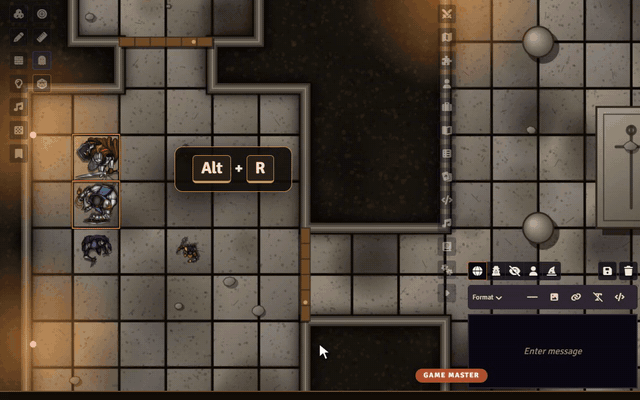</a>

### [Roll Requests](https://github.com/Sephral/sephrals-roll-requests)

**Ask the group for a roll with Alt+R.** Every roll is a button, and every result arrives on one live card.

[Foundry package](https://foundryvtt.com/packages/sephrals-roll-requests) · [GitHub](https://github.com/Sephral/sephrals-roll-requests) · <br>
<sub>Built in support for D&amp;D 5e, Pathfinder 2e, Savage Worlds and Crucible</sub>

</td>
<td width="50%" valign="top">

<a href="https://github.com/Sephral/sephrals-saved-encounters">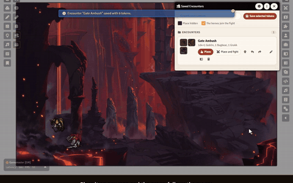</a>

### [Saved Encounters](https://github.com/Sephral/sephrals-saved-encounters)

**Save a group of monsters once and put it on any map in seconds.** A ghost preview follows the pointer, Q and E turn the formation.

[Foundry package](https://foundryvtt.com/packages/sephrals-saved-encounters) · [GitHub](https://github.com/Sephral/sephrals-saved-encounters) · 

</td>
</tr>
<tr>
<td width="50%" valign="top">

<a href="https://github.com/Sephral/sephrals-map-knowledge">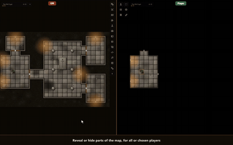</a>

### [Map Knowledge](https://github.com/Sephral/sephrals-map-knowledge)

**The party found the old map of the dungeon.** Mark those parts as known, and token vision keeps working.

[Foundry package](https://foundryvtt.com/packages/sephrals-map-knowledge) · [GitHub](https://github.com/Sephral/sephrals-map-knowledge) · <br>
<sub>Foundry v14 only</sub>

</td>
<td width="50%" valign="top">

<a href="https://github.com/Sephral/sephrals-handout-lens">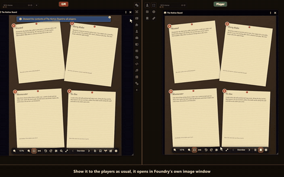</a>

### [Handout Lens](https://github.com/Sephral/sephrals-handout-lens)

**The writing on the letter is too small to read.** Players zoom in, hold Shift for a magnifying lens and page through the notes.

[Foundry package](https://foundryvtt.com/packages/sephrals-handout-lens) · [GitHub](https://github.com/Sephral/sephrals-handout-lens) · 

</td>
</tr>
<tr>
<td width="50%" valign="top">

<a href="https://github.com/Sephral/sephrals-token-tooltips">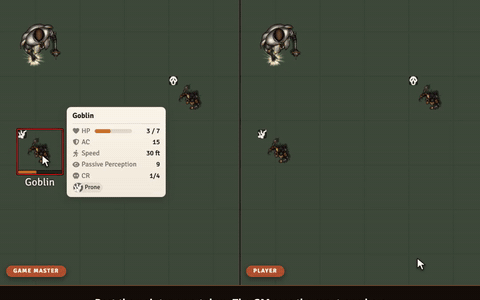</a>

### [Token Tooltips](https://github.com/Sephral/sephrals-token-tooltips)

**Rest the pointer on a token and see its health, armor, speed and conditions.** The GM decides for every value who sees it and how.

[Foundry package](https://foundryvtt.com/packages/sephrals-token-tooltips) · [GitHub](https://github.com/Sephral/sephrals-token-tooltips) · <br>
<sub>Presets for D&amp;D 5e, Pathfinder 2e, Savage Worlds and Crucible</sub>

</td>
<td width="50%" valign="top">

<a href="https://github.com/Sephral/sephrals-loot-ledger">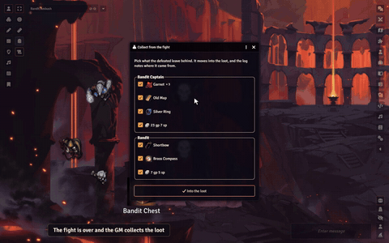</a>

### [Loot Ledger](https://github.com/Sephral/sephrals-loot-ledger)

**A shared party inventory with a fair loot table.** Need, Want or Pass, and coins are split without losing a copper.

[Foundry package](https://foundryvtt.com/packages/sephrals-loot-ledger) · [GitHub](https://github.com/Sephral/sephrals-loot-ledger) · <br>
<sub>Built in support for Crucible and D&amp;D 5e</sub>

</td>
</tr>
<tr>
<td width="50%" valign="top">

<a href="https://github.com/Sephral/sephrals-roll-triggers">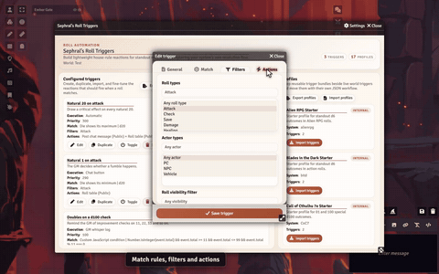</a>

### [Roll Triggers](https://github.com/Sephral/sephrals-roll-triggers)

**House rules for special rolls.** Natural 20s, fumbles, doubles. A trigger can post a message, roll on a table or run a macro.

[Foundry package](https://foundryvtt.com/packages/sephrals-roll-triggers) · [GitHub](https://github.com/Sephral/sephrals-roll-triggers) · <br>
<sub>Works with D&amp;D 5e 5.x and 6.x, MidiQOL and Ready Set Roll</sub>

</td>
<td width="50%" valign="top">

<a href="https://github.com/Sephral/sephrals-player-notes">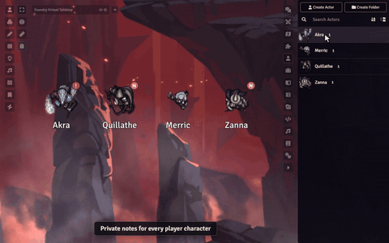</a>

### [Player Notes](https://github.com/Sephral/sephrals-player-notes)

**Private GM notes on player characters.** Story hooks, secrets, promises, debts. A dashboard shows what is still open.

[Foundry package](https://foundryvtt.com/packages/sephrals-player-notes) · [GitHub](https://github.com/Sephral/sephrals-player-notes) · 

</td>
</tr>
</table>

## Behind the scenes

Keep the world in order between sessions.

<table>
<tr>
<td width="50%" valign="top">

<a href="https://github.com/Sephral/sephrals-image-paste-drop">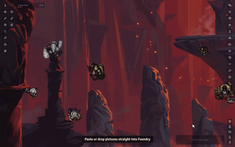</a>

### [Image Paste & Drop](https://github.com/Sephral/sephrals-image-paste-drop)

**Paste an image with Ctrl+V or drop it onto Foundry.** Then decide what it becomes: a scene, a tile, a token image, a chat post.

[Foundry package](https://foundryvtt.com/packages/sephrals-image-paste-drop) · [GitHub](https://github.com/Sephral/sephrals-image-paste-drop) · 

</td>
<td width="50%" valign="top">

<a href="https://github.com/Sephral/sephrals-content-backup-restore">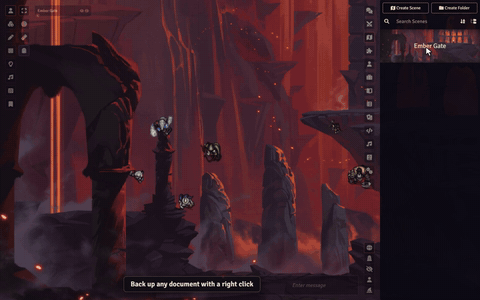</a>

### [Content Backup & Restore](https://github.com/Sephral/sephrals-content-backup-restore)

**Named backups for scenes, actors, items and more.** Restore a document from any backup or recover one that was deleted.

[Foundry package](https://foundryvtt.com/packages/sephrals-content-backup-restore) · [GitHub](https://github.com/Sephral/sephrals-content-backup-restore) · 

</td>
</tr>
<tr>
<td width="50%" valign="top">

<a href="https://github.com/Sephral/sephrals-module-loadouts">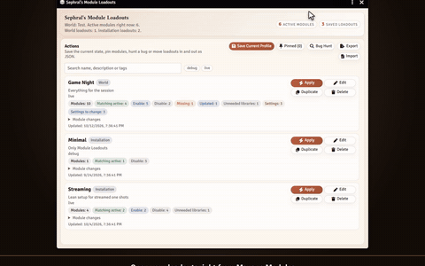</a>

### [Module Loadouts](https://github.com/Sephral/sephrals-module-loadouts)

**Save the active modules as a named loadout and switch with one click.** After the restart it checks that everything came up as planned.

[Foundry package](https://foundryvtt.com/packages/sephrals-module-loadouts) · [GitHub](https://github.com/Sephral/sephrals-module-loadouts) · 

</td>
<td width="50%" valign="top">

<a href="https://github.com/Sephral/sephrals-file-commander">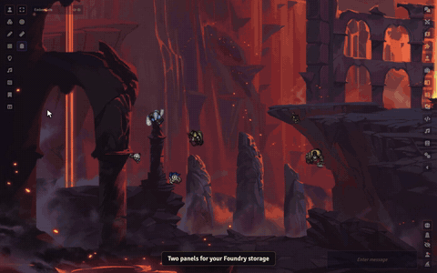</a>

### [File Commander](https://github.com/Sephral/sephrals-file-commander)

**A file manager with two panels side by side.** Controlled by keyboard, like the classic commanders.

[Foundry package](https://foundryvtt.com/packages/sephrals-file-commander) · [GitHub](https://github.com/Sephral/sephrals-file-commander) · 

</td>
</tr>
</table>

## Install by link

<table>
<tr>
<td width="50%" valign="top">

A module that is not in Foundry's module search installs by its link, the manifest URL.

1. In Foundry's setup screen open **Add-on Modules** and click **Install Module**.
2. Paste the link into **Manifest URL** at the bottom of the window.
3. Click **Install**, then enable the module in your world.

On The Forge open the Bazaar, click **Install From Manifest** and paste the link.

</td>
<td width="50%" valign="top">

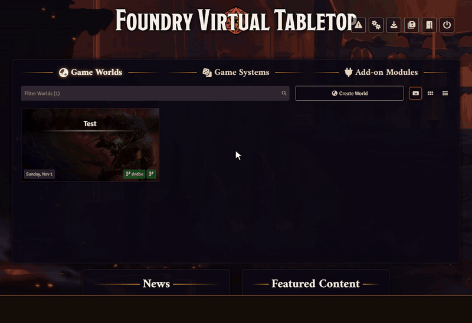

</td>
</tr>
</table>

## Support

Questions, ideas and bug reports are welcome on [Discord](https://discord.gg/7BjCgDYaBP) or as an issue in the repository of the module.

<sub>Foundry Virtual Tabletop is a trademark of Foundry Gaming LLC. Crucible and Ember belong to their creators. These modules are independent fan projects and are not affiliated with or endorsed by Foundry Gaming LLC or the creators of Crucible and Ember.</sub>
